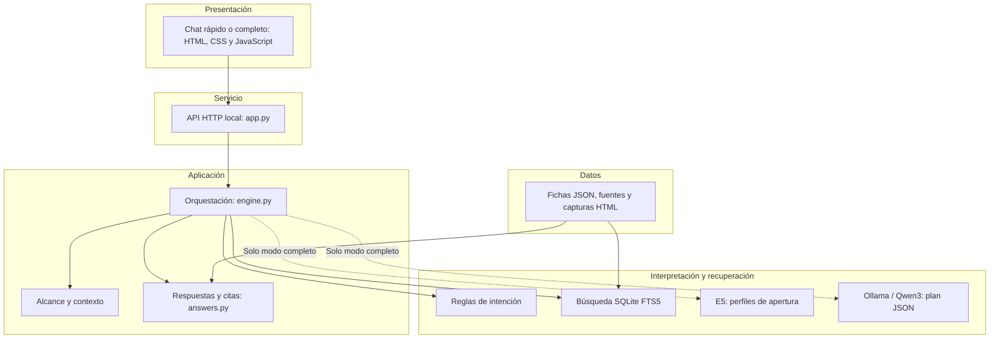
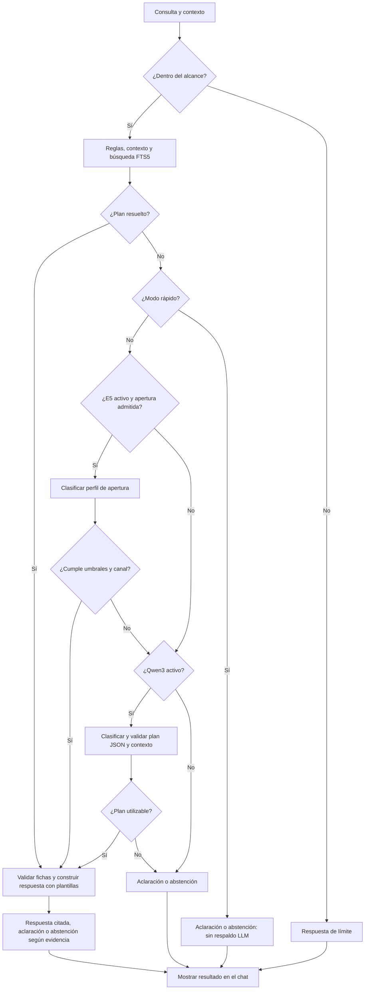

# Asistente de consulta Banamex

> Consultas bancarias con respuestas basadas en fuentes públicas y trazables.


## Instrucciones de arranque

Descarga y descomprime el proyecto, o clona el repositorio. Elige tu plataforma:

| Opción | Guía de inicio |
| :--- | :--- |
| **Ejecución rápida — sin modelos** | [Iniciar sin Ollama ni Qwen3](docs/INSTRUCCIONES_RAPIDO.md) |
| **Windows — completo** | [Iniciar en Windows](docs/INSTRUCCIONES_WINDOWS.md) |
| **macOS — completo** | [Iniciar en macOS](docs/INSTRUCCIONES_MACOS.md) |
| **Linux / WSL — completo** | [Iniciar en Linux](docs/INSTRUCCIONES_LINUX.md) |
| **Docker — opcional** | [Iniciar con Docker](docs/INSTRUCCIONES_DOCKER.md) |

El **modo rápido** reutiliza Python si está disponible y evita las descargas de modelos. Los **iniciadores completos** preparan Python, E5 y Ollama/Qwen3; su primera ejecución necesita internet y puede tardar varios minutos.

| Modo | Componentes | Si no resuelve una consulta |
| :--- | :--- | :--- |
| **Rápido** | Reglas, SQLite FTS5 y fichas | Aclaración o abstención; **sin fallback hacia LLM** |
| **Completo** | Lo anterior, E5 y Qwen3 mediante Ollama | Puede consultar Qwen3; conserva aclaraciones y abstenciones si no logra resolver |

El modo rápido **no utiliza E5 ni consulta Ollama**, aunque ya estén instalados. Puede reconocer menos formulaciones; no se deben atribuirle las métricas del modo completo.

---

## Descripción general

Este prototipo facilita la consulta del contenido público de Banamex mediante un chat en **español e inglés**. Está pensado para demostrar cómo atender preguntas frecuentes de clientes y prospectos sobre **Joy, Clásica, MiCuenta y Switch**, con un alcance acotado que los desarrolladores puedan revisar y evaluar.

- **Fuentes trazables:** fichas y capturas locales con URL y fecha de recolección.
- **Interpretación de consultas:** reglas, búsqueda textual, embeddings E5 y clasificación con Qwen3.
- **Control de respuestas:** citas, solicitudes de aclaración y abstención ante evidencia insuficiente.

**Es un ejercicio de evaluación, no un canal oficial.** No accede a cuentas, consulta saldos ni realiza trámites. Las fuentes son capturas locales; las tarifas no se verifican en tiempo real.

---

## Stack tecnológico

| Categoría | Tecnología |
| :--- | :--- |
| **Backend / Core** | Python 3.13 en los iniciadores; servidor HTTP de la biblioteca estándar |
| **Interfaz** | HTML, CSS y JavaScript |
| **Búsqueda textual** | SQLite FTS5 en memoria |
| **Modelos locales — modo completo** | Ollama con Qwen3:4b; multilingual-e5-small con ONNX Runtime en CPU |
| **Herramientas / Librerías** | uv, NumPy y Tokenizers |
| **Infraestructura** | Ejecución local; Docker Compose opcional con Python 3.14 |

---

## Arquitectura por capas

La interfaz y el motor se ejecutan localmente. Las flechas representan dependencias entre componentes; **E5 y Qwen3 interpretan consultas solo en el modo completo**; el modo rápido usa reglas y FTS5. Ambos construyen respuestas visibles con fichas y plantillas.



### Flujo de una consulta

El motor prioriza reglas y recuperación local. **En modo rápido, una consulta sin resolver va directamente a aclaración o abstención: no hay respaldo hacia LLM.** En modo completo, E5 puede clasificar consultas de apertura y Qwen3 puede interpretar las consultas restantes. Si Qwen3 falla, se conserva una respuesta local de aclaración o abstención.



---

## Requisitos previos e instalación

### Requisitos

- **Sistema compatible de 64 bits:** Windows 10 22H2+, macOS 14+ o Linux/WSL con glibc 2.28+. Consulta los requisitos específicos en la guía de tu plataforma.
- **Internet** si es necesario preparar Python o dependencias; el modo completo también descarga modelos.
- **Modo completo:** como referencia, 8 GB de RAM y 15 GB libres, no mínimos medidos. El modo rápido evita el espacio y el cómputo de los modelos.
- **Git**, solo si prefieres clonar. Los iniciadores pueden preparar Python. Solo el modo completo instala Ollama y puede solicitar Microsoft Visual C++ en Windows.
- **Docker**, únicamente si eliges esa alternativa.

### Pasos de instalación

1. **Clona el repositorio** con Git, o descarga el código desde GitHub:

   ```bash
   git clone https://github.com/JFRo57/caso_practico_banamex.git
   cd caso_practico_banamex
   ```

2. **Sigue la guía de tu plataforma** enlazada al inicio. Allí encontrarás el arranque, la preparación inicial y cómo detener el chat.

---

## Documentación y resultados

- [Matriz de resultados en Excel](Reporte_final_Banamex.xlsx).
- [Nota de diseño](docs/NOTA_DISENO.pdf).
- [Resultados y límites de la evaluación](docs/RESULTADOS.md).
- [Configuración técnica y estado de validación](docs/CONFIGURACION.md).
- [Bitácora del proyecto](docs/BITACORA.md).

**Validación:** se probaron Linux y los instaladores de Windows en entornos nuevos del proyecto, incluida la preparación automática de zonas horarias. No equivale a una máquina limpia: la prueba completa de Windows reutilizó Visual C++ y el servicio Ollama existentes. macOS y Docker completo siguen pendientes. Consulta la [evidencia y sus límites](docs/CONFIGURACION.md).
